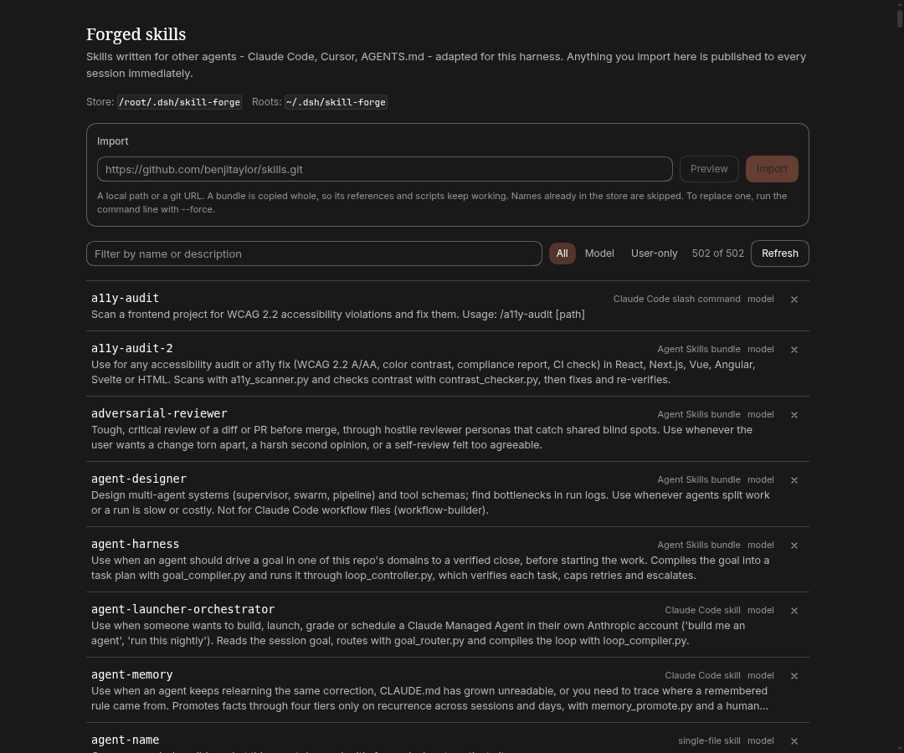

# dsh-skill-forge

Import AI skills written for *other* agents into [DeepSeek Harness](https://github.com/deepseek-ai/deepseek-harness)
and publish them as native DSH skills.

[](https://www.npmjs.com/package/@frederickimanuels/dsh-skill-forge)
[](https://github.com/topics/dsh-plugin)
[](LICENSE)
[](#tests)

<br clear="left">

Every agent ecosystem invented its own skill format. Claude Code has `SKILL.md` plus
slash commands. Cursor has `.cursor/rules/*.mdc`. Codex has `AGENTS.md`. Half the
ecosystem ships bare Markdown with no frontmatter at all. None of it loads in DSH,
which wants a kebab-case `name`, a non-empty `description`, invocation flags and a
resource base.

`dsh-skill-forge` is a DSH plugin that reads all of those, adapts them, and
registers them as first-class skills — no rewriting your files, no fork of the
skill, no copy step required.

```
$ dsh-skill-forge scan .
agents     repository instructions  user-only  repo-instructions:AGENTS.md
stageshow  Agent Skills bundle      model      agent-skills:stageshow/SKILL.md

2 skills would be published.
```



## Install

```bash
dsh plugin --profile web add @frederickimanuels/dsh-skill-forge
```

Until the package is published, the same command works against the repository:

```bash
dsh plugin --profile web add "git+https://github.com/frederickimanuels/dsh-skill-forge.git"
```

or from a local checkout, while you are iterating on it:

```bash
dsh plugin --profile web add "file:$PWD"
```

The package has no build step — the published files are the source — so a git install
needs no `prepare` script and no pnpm build allowance.

Either way the profile stores the package under its scoped name, so the bundle row
in your composed config reads `@frederickimanuels/dsh-skill-forge`.

Verify the layer resolved:

```bash
dsh --profile web --dump-config | grep -A2 skill-forge
```

Then restart the web host once so it loads the new bundle, and open **Skills** in the
sidebar.

### Compatibility

`engines.dsh` declares the harness releases this bundle supports, and the harness
reads it before it imports a line of plugin code:

```json
"engines": { "node": ">=20", "dsh": ">=0.2.1-rc.2 <0.4.0-0" }
```

Installation and profile startup refuse a bundle whose range the running DSH does not
satisfy. The range must sit at the **root** `engines` object — a nested
`dsh.engines` block is read by nothing, and the check silently falls back to the
`@deepseek-ai/dsh*` peer ranges instead.

The sidebar icon comes from `package.json` `icon`, which the loader resolves as a
relative path inside the package (SVG, PNG, JPEG or WebP, at most 256 KiB).

## What it understands

| Dialect | What it looks like | Invocation |
| --- | --- | --- |
| **Agent Skills bundle** | `<dir>/SKILL.md` with `name` + `description` ([spec](https://agentskills.io)) | model + user |
| **Claude Code skill** | `SKILL.md` using Claude-only keys (`allowed-tools`, `argument-hint`, …) | per `disable-model-invocation` |
| **Claude Code command** | `.claude/commands/*.md` | per `disable-model-invocation` |
| **Single-file skill** | any `.md` with YAML frontmatter | model + user |
| **Cursor rule** | `.cursor/rules/*.mdc` (`description`, `globs`, `alwaysApply`) | per `alwaysApply` |
| **Legacy Cursor rules** | `.cursorrules` | model + user |
| **Repository instructions** | `AGENTS.md`, `CLAUDE.md`, `GEMINI.md`, `CODEX.md`, `.github/copilot-instructions.md` | user-only |
| **Loose Markdown** | prose files, opt-in via `includeLoose` | model + user |

Repository instructions default to **user-invocable only**. An `AGENTS.md` describes
a whole repository; making it model-invocable would let it win unrelated requests.
It stays reachable by name, and the file's own frontmatter can override that.

A directory containing `SKILL.md` is treated as a bundle: its `references/`,
`scripts/`, `assets/`, `examples/`, `templates/` and `resources/` ship as the
skill's resources, and the scan does not descend into it — sibling Markdown files
belong to the skill, not to the catalog.

## What "adapt" means

The plugin never modifies your files. It rewrites the content it publishes:

- `!`command`` (Claude's dynamic context injection) becomes "the output of the
  command `command`". DSH does not run it for you, so the instruction stays actionable
  instead of turning into punctuation the model cannot interpret.
- `@path/to/file` references become "the file `path/to/file`" so the model is not
  left looking for a mention syntax DSH does not have.
- `$ARGUMENTS`, `$1` … `$9` become "the user's request".
- `allowed-tools` is translated to DSH tool names where a mapping exists
  (`Read` → `read`, `WebFetch` → `web_fetch`, `Task` → `subagent`, …) and reported
  as an unmapped grant where it does not. Nothing is enforced or hidden — the grant
  is advisory text in the skill, exactly as it was in the source format.
- A short preamble records where the skill came from, what it was adapted from, and
  what was rewritten.

Skills missing a `description` get one derived from the first real paragraph of the
body (headings are skipped — a title describes the file, not the task). Missing
names are derived from the directory or file name and slugified to the harness
grammar. A bad skill is adapted, not rejected, unless it cannot be named at all.

## Configuration

All keys are optional; the defaults are what most people want.

```yaml
- id: skill-forge
  name: '@frederickimanuels/dsh-skill-forge'
  config:
    providerName: skill-forge      # provider name on ctx.skills
    roots:                         # extra directories to scan
      - ~/.dsh/skill-forge
    autoDiscover: true             # also read .claude/, .cursor/, AGENTS.md … per project
    includeLoose: false            # import Markdown with no frontmatter
    depth: 3                       # directory depth per root
    maxFiles: 2000                 # total file budget; warns when exhausted
    exclude: []                    # extra directory names to skip (additive)
    deny: []                       # skill names to refuse
    rankBoost: 0                   # add to every rank; negative outranks host skills
    includeCommandArgumentHint: true
    watch: true                    # rescan when files change
    logAdaptations: true           # log each skill every time the catalog is rebuilt
    store: ~/.dsh/skill-forge      # where the Skills page imports into
    ui: true                       # serve the Skills page and its bridge
```

With `autoDiscover`, each project you open contributes whatever it already has under
`.claude/skills`, `.claude/commands`, `.agents/skills`, `.cursor/rules`,
`.cursorrules`, `AGENTS.md`, `CLAUDE.md` and `.github/copilot-instructions.md`.

### Rank: why forged skills never shadow yours

The skill registry sorts candidates by ascending rank and keeps the first, so a
*lower* number wins. The bundled filesystem provider uses `100` (project skills)
through `600` (bundled skills). Forged skills start at `620`, so importing a
`pdf-tools` skill never displaces a `pdf-tools` you wrote yourself. Set
`rankBoost: -100` if you explicitly want an import to win.

## The Skills page

With the web profile there is a **Skills** entry in the sidebar — and the same panel
at **Settings → Skills** — that does what the CLI does without a terminal:

- lists every skill in the store as a dense row: name, dialect, whether the model
  may invoke it, and a two-line description — a few hundred skills stay scannable;
- filters that list by name or description and by invocation (all / model / user-only),
  with a live `shown of total` count;
- imports a local path or a git URL, with a **Preview** button that shows what the
  source would contribute before anything is copied;
- removes a skill from the row itself — the remove glyph appears on hover or focus,
  then asks for a second click before anything is deleted.

The page owns its scroll container: `.sf-page` is a `flex: 1 1 auto` column with
`min-height: 0` and `.sf-pageScroll` below it is the only `overflow: auto` box. Nothing
above it in the frame scrolls — the layout shell clips overflow on purpose — so a page
that forgets a scroller is simply cut off at the viewport. Keep those two rules if you
restyle it.

The sidebar entry and the settings section are two registrations over one component,
so they never disagree about what is in the store. A destination in the DSH sidebar
is exactly two slot registrations sharing one id: a `sidebar.panellist` row (the
shell paints the button, label and active state; the plugin supplies only the glyph)
and a `main` entry keyed by that same id, which the frame renders when the row is
clicked. The glyph is drawn inline because `client/index.js` may require nothing but
React.

The page is a client module (`client/index.js`, declared as `dsh.client` in
`package.json`) and it never touches the filesystem: it calls five JSON routes under
`api/dsh-skill-forge` (`state`, `preview`, `import`, `remove`, `store`) that the host
half registers. A request from another origin is refused. Because the page and the
CLI share `src/store.js`, both do exactly the same thing to the store — that is also
why `--force` exists only on the CLI, where a half-finished import is easy to see.

Set `ui: false` in the config to serve no page and no routes, for a profile with no
web server or one where you would rather not expose them.

## CLI

```bash
dsh-skill-forge scan [paths...]     # what would be published, from anywhere
dsh-skill-forge import <source>     # copy a directory or git repo into the store
dsh-skill-forge list                # what is in the store
dsh-skill-forge remove <name>       # delete one skill from the store
dsh-skill-forge doctor              # store, ranks, and what this project offers
```

The commands above are the binary the profile installs (`dsh-skill-forge`, from the
package's `bin` field). From a checkout without a global install, use
`node bin/forge.js scan …` instead.

`import` accepts a local path or a git URL and copies the *whole bundle*, so
`references/` and `scripts/` keep working. It never overwrites without `--force`, and
`--dry-run` shows the plan first.

`scan` and `list` describe the same corpus and therefore agree line for line,
including the `model`/`user-only` column — that column is read from the adapted
skill, not guessed from the dialect. Both stop at a skill budget (2000 by default):
`scan` says so on stderr, and `import` refuses a source larger than the budget
rather than copying a prefix that would look complete.

```bash
dsh-skill-forge import https://github.com/benjitaylor/skills.git
```

### The first example: benjitaylor/skills

```bash
git clone --depth 1 https://github.com/benjitaylor/skills.git /tmp/bt-skills
dsh-skill-forge scan /tmp/bt-skills
dsh-skill-forge import /tmp/bt-skills
```

```
agents     repository instructions  user-only  repo-instructions:AGENTS.md
stageshow  Agent Skills bundle      model      agent-skills:stageshow/SKILL.md
```

`stageshow` is already standards-compliant, so it imports unchanged and its 15
`references/*.md` files and `scripts/*.mjs` stay addressable through the skill's
resource base. The repository's `AGENTS.md` — which no other agent would present to
the model as anything addressable — becomes a user-invocable skill.

The repo's `CLAUDE.md` is not imported: it contains exactly one line, `@AGENTS.md`,
which is a redirect rather than instructions. Publishing it would put a catalog entry
whose entire body is a file path next to the real instructions it points at, so the
redirect is reported and skipped.

## Design notes

**No runtime dependencies.** The plugin imports only packages the harness already
provides (`@deepseek-ai/cordis`, `@deepseek-ai/schemastery`) and Node built-ins. YAML
frontmatter is parsed by a small purpose-built parser in `src/frontmatter.js`; a
skill whose frontmatter it cannot parse still imports (the parse error is reported
in the skill's preamble) rather than disappearing.

**No bundler, no build step.** The published files are the source: `package.json`
points `main` at `src/index.js`, plain ESM, so a profile loads it straight from
`node_modules`. The bundle descriptor is `dsh/cordis.patch.yml`. The browser half is
hand-written CJS-in-a-factory (`window.__ModuleLoader__.load`) that requires only
`react` from the modules the harness already seeds, and it builds its DOM with
`React.createElement` rather than JSX — a transform step would buy nothing but a
toolchain.

**Failures are local.** A missing root, an unreadable file, a duplicate provider
name or a skill that cannot be named produces a warning and skips that item. Nothing
in this plugin can take a profile down.

**Live catalog.** The provider watches every configured root with `fs.watch` and
invalidates the registry cache when a file changes, so an edit or a `forge import`
shows up without restarting the host. A root that does not exist yet is watched
through its nearest existing ancestor and upgraded to a recursive watcher the moment
it appears — which is what makes the normal first-run sequence (start the host, then
import skills) work without a restart.

## Permissions and trust

- **No network access.** The plugin never calls out. `import` runs `git clone` and
  `cp` against the source you name; nothing else leaves the machine.
- **No skill scripts are executed.** Importing copies files into the store. A skill's
  `scripts/` directory is published as a resource, and the model only runs something
  from it if you ask it to.
- **Local HTTP routes.** With `ui: true` the host half serves five JSON routes under
  `/api/dsh-skill-forge` (`state`, `preview`, `import`, `remove`, `store`) on the same
  origin as the DSH web server, behind the same authentication. A request from another
  origin is refused. Set `ui: false` to register no routes at all.
- **Writes only inside the store.** The default store is `~/.dsh/skill-forge`.
  `remove` deletes a directory below it; nothing outside it is touched.
- **No runtime dependencies.** No transitive supply chain: only the harness packages
  and Node built-ins are imported.

## Publishing

This package is an npm-installable DSH **bundle**: `package.json` declares
`dsh.bundle.patch` and the patch file names the plugin rows a profile composes.
That is what `dsh plugin add` installs and what the Plugin Hub indexes.

To cut a release:

```bash
npm pack --dry-run                 # what ships: 20 files, no build output needed
npm login                          # if you are not authenticated yet
npm publish --access public        # scoped, so --access public is required
git tag v0.1.0 && git push origin master --tags
```

If `npm config get registry` points at a mirror, pass the public registry
explicitly or the upload lands somewhere users cannot install from:

```bash
npm publish --access public --registry=https://registry.npmjs.org
```

Users then install with `dsh plugin --profile web add @frederickimanuels/dsh-skill-forge`.

**Discovery.** Three things get a plugin into the catalog, and the first one is the
only one that cannot be skipped:

1. The repository carries the `dsh-plugin` GitHub topic. New repositories are found
   by topic only.
2. `repository` in `package.json` points at that same `owner/repo`. If it points
   somewhere else the npm package cannot be bound to the entry and the plugin stays
   GitHub-install-only.
3. The package is published to npm. The **in-app** Settings → Plugin Hub market
   only lists one-step npm installs, so a git-only plugin is indexed on
   [dsh-plugin.org](https://dsh-plugin.org) but never appears inside DSH.

The catalog is rebuilt daily from the topic, and
[an issue on the hub repo](https://github.com/dshplugin/dsh-plugin-hub/issues/new)
with the *Plugin submission* template gets a human to look at a new entry sooner.

## Developing

`dsh plugin add "file:…"` installs a **pnpm snapshot**, not a symlink: edits to this
checkout do not reach a running profile until you re-run the `add` command. The
browser half is read once at host boot, so a change under `client/` also needs the
restart below; the host half is re-read on reload. From a checkout that is:

```bash
dsh plugin --profile web add "file:$PWD"   # refresh the snapshot
systemctl restart dsh-web                  # restart the host to load it
```

## Tests

```bash
npm test
```

126 tests cover the frontmatter parser, dialect detection, discovery (symlink loops,
excludes, bundle non-descent, redirect files), adaptation, tool-grant rewriting, the
provider's cache, rehydration and live-refresh watchers, the plugin mounted into a
real `SkillRegistry`, the CLI, the shared store module, the settings bridge routes
(including the cross-site refusal), and the client manifest.

## License

MIT